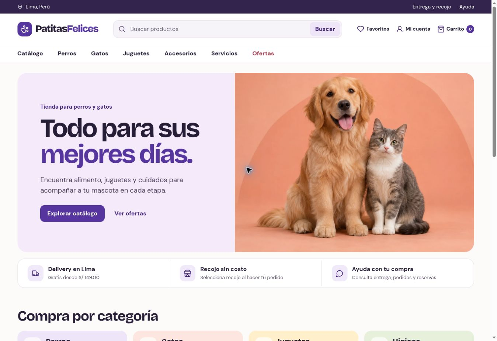

# Patitas Felices

**Tienda de demostración para perros y gatos, en español y con precios en soles.**

[Ver la tienda en GitHub Pages](https://bryanonkeys.github.io/web-petshop/) · [Ejecutar en local](#ejecutar-en-local)



## Qué puedes probar

| Sección | Funcionalidad |
| --- | --- |
| Catálogo | Busca por nombre o marca y filtra por mascota, categoría, etapa de vida, precio y disponibilidad. Explora ofertas y guarda favoritos. |
| Producto | Cambia la presentación, consulta su stock y elige cuántas unidades agregar. |
| Compra | Edita el carrito, calcula el delivery por distrito de Lima o elige recojo. Cada pedido genera una referencia para consultarlo en el historial. |
| Servicios | Elige baño, peluquería o corte de uñas, guarda un turno y cancélalo desde tu perfil. |
| Cuenta y ayuda | Edita tu perfil local, repite un pedido y consulta las condiciones de entrega y las guías de compra. |

El stock, los precios, los envíos y los horarios usan datos de demostración. Los favoritos, el carrito, los pedidos y las reservas se guardan en el navegador. El pago al recibir es simulado.

## Ejecutar en local

Requiere Node.js 22 o superior y npm.

```bash
git clone https://github.com/BryanOnKeys/web-petshop.git
cd web-petshop
npm ci
npm run dev
```

Abre la URL que indique Vite. Usa `npm test` para verificar filtros, stock, tarifas, pedidos, reservas y recuperación de datos. Ejecuta `npm run lint` para revisar el código y `npm run build` para generar `dist/`.

## Cómo está organizado

| Ruta | Responsabilidad |
| --- | --- |
| `src/features/catalog` | Productos, presentaciones, precios y filtros. |
| `src/features/commerce` | Carrito, cálculo de entrega, pedidos, reservas y persistencia. |
| `src/components` y `src/pages` | Interfaz compartida y pantallas de la tienda. |
| `src/routes` | Navegación y enlaces de las categorías existentes. |
| `src/styles` | Sistema visual y layouts adaptables. |
| `test/commerce.test.mjs` | Pruebas de las reglas de compra y reservas. |

GitHub Actions comprueba el código, ejecuta las pruebas y publica la compilación de `main` en GitHub Pages. Las rutas de esa versión usan `#` para que los enlaces a productos y al carrito funcionen al abrirlos o recargarlos.

Proyecto de portafolio de [BryanOnKeys](https://github.com/BryanOnKeys). La navegación por categorías y las opciones de entrega tomaron como referencia [SuperPet](https://www.superpet.pe/perro/alimentos-y-snacks) y [Mascoterías](https://mascoterias.com/).
